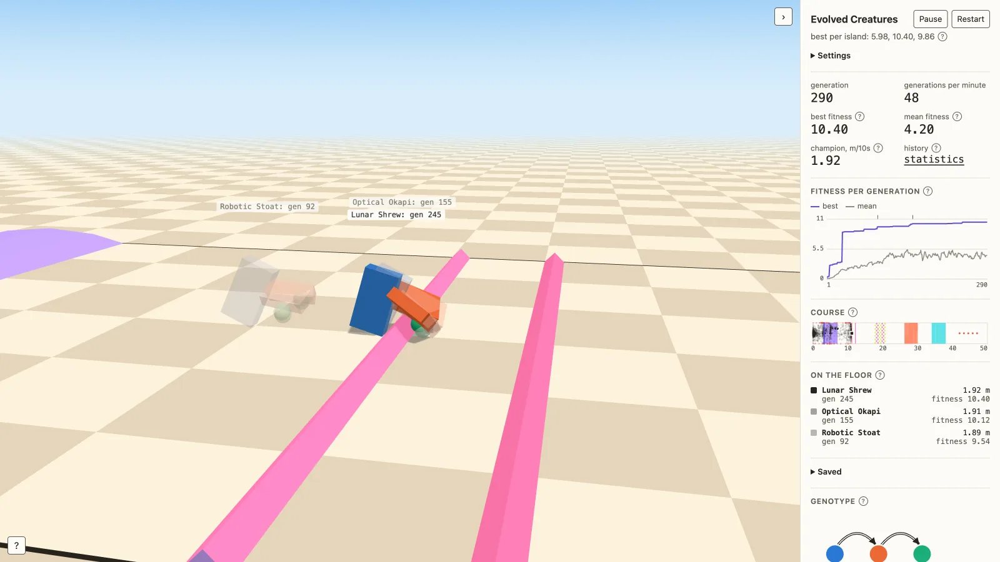
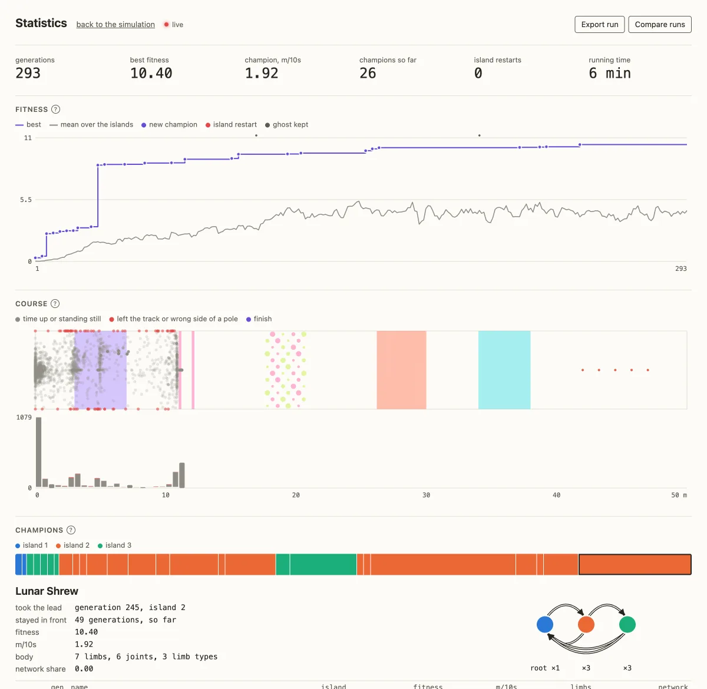

```
███████╗██╗   ██╗ ██████╗ ██╗     ██╗   ██╗███████╗██████╗
██╔════╝██║   ██║██╔═══██╗██║     ██║   ██║██╔════╝██╔══██╗
█████╗  ██║   ██║██║   ██║██║     ██║   ██║█████╗  ██║  ██║
██╔══╝  ╚██╗ ██╔╝██║   ██║██║     ╚██╗ ██╔╝██╔══╝  ██║  ██║
███████╗ ╚████╔╝ ╚██████╔╝███████╗ ╚████╔╝ ███████╗██████╔╝
╚══════╝  ╚═══╝   ╚═════╝ ╚══════╝  ╚═══╝  ╚══════╝╚═════╝
════════════════════ c r e a t u r e s ════════════════════
```

Block creatures that evolve a body and a way to move, in the browser. The model
follows Karl Sims' ["Evolving Virtual Creatures"](https://www.karlsims.com/evolved-virtual-creatures.html) (1994): a genome is a small
directed graph, each node a box-shaped limb with a hinge joint, each connection
a place on the parent's surface to attach a child limb. Self-connections make chains, mirrored
connections make pairs of legs. The physics is [MuJoCo](https://mujoco.org/),
compiled to WebAssembly through its
[JavaScript bindings](https://github.com/google-deepmind/mujoco/tree/main/wasm).

Live: https://tlausz.github.io/Playground/evolvedCreatures/



Three islands of 30 creatures evolve side by side and take turns. Every
generation, the creatures of one island get two seconds to get going and six
seconds to cover ground. They may move from the start, but only the six
seconds count, so falling over gains nothing while a run-up does. The six best survive, the rest are mutated copies of them,
some of them crossed or grafted with a second parent as in Sims' paper. The
page replays the current champion while the next generation is evaluated in the
background. Every 100 generations the champion is kept as a ghost, and the last
three ghosts run alongside the current one, so you can see how far evolution
has come. Drag to orbit the camera, scroll to zoom, or use the keys: W, A, S
and D move the view, R resets it, H shows or hides the panels, Space
pauses.

Tumbling does not count: fitness is the metres covered times an upright
factor, and a creature that flips its root limb over scores zero. Walking and
crawling win over rolling.

By default the creatures run a fixed 50 m obstacle course: two bumps, two low
bars, a band of 48 loose balls of different size and weight, a staircase up and down, four wedges
tilted to alternate sides and a slalom of five poles. Only progress towards the finish counts, a run lasts
60 seconds instead of six, and leaving the track, passing a pole on the wrong
side or making no progress for ten seconds ends the run at that point. Start under Settings puts the creatures right in
front of an obstacle. `course.html` lets you fly through the course
on its own. Switch Course off under Settings for the open checkerboard.

With Jump on, creatures evolve to jump instead: fitness is the greatest height
of their lowest point above the floor. On the course, jump height adds a
small bonus to the progress towards the finish.
Max size, 60 cm by default, shrinks larger creatures as a whole, otherwise a
giant would step over every obstacle.

Limbs can be boxes, spheres, capsules, cylinders or ellipsoids; Round shapes
under Settings switches back to boxes only, as in Sims' creatures.

The joints are driven by sine oscillators, one frequency per creature, with a
phase that adds up along the limbs. Optionally, under Settings, every limb type
also carries a small neural network, as in Sims' local neurons: it reads the joint's own
angle, its parent's angle, ground contact and the tilt of the body, and adds
its output to the rhythm. A new network starts silent, so evolution begins
from the plain rhythm. The panel on the left then shows each network with its live
activations. It is off by default: in hour-long runs evolution did better
without it, and often silenced the network on its own. Hovering a name in the list outlines that creature in red.

Every creature gets a name derived from its genome, such as Pneumatic Gecko.
Limbs are coloured by the genome node they were built from. The panel on the
right, which can be folded away, shows the fitness curve, the metres each creature on the floor covered,
the genotype graph of the champion, and the target and actual angle of every
joint.

Progress is kept in `localStorage`, so evolution continues where it stopped.
Hover a name in the list to save that creature. Saved creatures can be shown
in the race, seeded into the running evolution, renamed, deleted, and exported
or imported as a JSON file.

Pause stops evolution and replay. Press Restart twice, or add `?reset` to the
URL, to start over.

The Settings section of the panel has sliders for inheritance (mutations,
crossover, grafting), selection (population, survivors, islands), body
(limbs, limb types, mirroring, chain length) and the trial. Randomize rolls all of
them, Apply starts a new run. A faint knob on each slider marks the default. Every changed setting shows up in the address
bar, so a link such as `?islands=1&pop=60` reproduces a setup.

Inspired by the breveCreatures screensaver and by "The Simsulator"
([paper](https://direct.mit.edu/isal/proceedings/isal2024/36/84/123510),
[code](https://github.com/mycoolfin/the-simsulator)) by Finn and Bräunl,
ISAL 2024, which rebuilt Sims' model in Unity.

## Statistics

`stats.html` charts the run that is going on in the other tab: fitness with
every new champion, island restart and ghost, a band of all champions with their
genotype, the islands, the body of the champion, how much its networks change
the rhythm, and the pace. Runs can be exported and compared. It opens from the
history tile in the panel.



## Long runs

`node scripts/night_run.mjs 8h --runs 4 mutations=3` runs the same evolution
without a browser, several runs in parallel, and keeps the Mac awake while it
works. Each run writes a file to `runs/` that the statistics page can load
under Compare runs.

## Running it

Double-click `index.html`. It needs a network connection: [Three.js](https://threejs.org/) and the
MuJoCo bindings (`@mujoco/mujoco`, 11 MB of WebAssembly) come from jsDelivr.

For a copy that runs without a server and without a network, for example as
a screensaver, run `python3 scripts/build_offline.py`. It writes
`Evolved Creatures offline.html`, a single 17 MB file with every dependency
embedded.

## Files

`index.html` holds the simulation, `stats.html` the statistics, `course.html` a fly-through of the course, no build step. `DESIGN.md` describes the
palette. `scripts/build_offline.py` makes the standalone copy.

## License

MIT, like the rest of the repository. The page loads MuJoCo (Apache-2.0) and
Three.js (MIT) from jsDelivr. The offline copy embeds both, so if you pass it
on, include their license texts.
