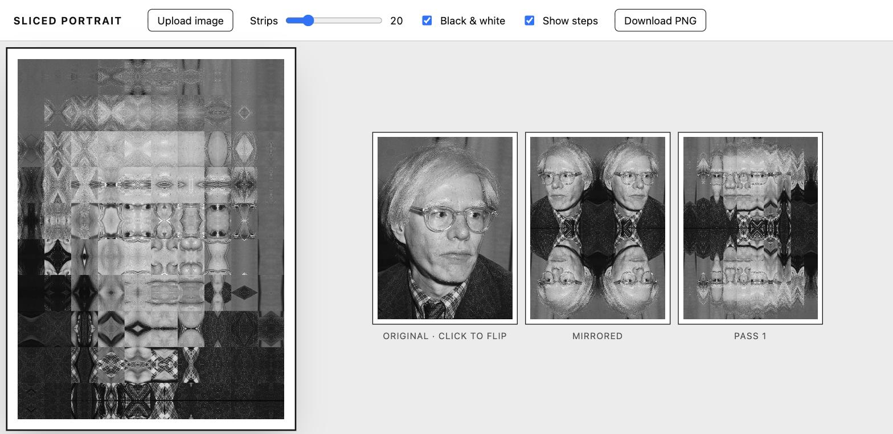

# Sliced Portrait

Live: <https://tlausz.github.io/Playground/sliced-Portrait/>

An image, mirrored into a 2x2 grid, cut into vertical strips, each strip turned 90 degrees and stacked into a new image. Done twice, the picture dissolves into a symmetric tile pattern. Works with any image or logo, portraits just make the mirror axes obvious. Inspired by the paper-and-scalpel version by tete.au.carre on Instagram. One HTML file, Canvas 2D, no dependencies.

- Upload your own image or SVG, or start with the default portrait.
- Strips: how many cuts per pass (10 to 60). Two passes, always.
- Click the Original step to flip the source, so the faces look outward in the mirrored grid.
- Black & white toggle.
- The mirrored sheet sits next to the result. Hover either one to number every cell and see where each piece ended up (up to 15 strips).
- Animate: watch the strips fly into place, both passes, then the sheet turns. Loop it if you like.
- Export: pick or type the long edge in pixels, WebP, JPEG or PNG. The image is recomputed at that size from the upload, never upscaled from the preview.
- SVG export, for SVG sources: the original goes in once, untouched, and every cell is a clipped, transformed reference to it. Gradients, filters and text survive; apply the clip masks in your vector editor if you need real cut edges.

Runs from `file://` too.
