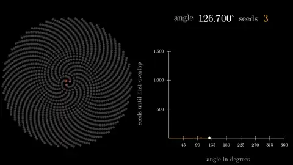

# Sunflower seeds

Live: <https://tlausz.github.io/Playground/sunflower/>

What's the best angle to fit the most seeds into a sunflower? Each seed sits one fixed turning angle further round than the one before and a little further out (Vogel's model: the radius grows with the square root of the seed number). The head is a fixed circle and every seed has the same size. For each angle the video packs in as many seeds as fit without two of them overlapping, and the graph on the right records the count. The angle sweeps from 0 to 360 degrees in steps of 0.1 degree.

Most angles leave gaps: the seeds line up in spokes or loose spirals, and only a few hundred fit. At 130 degrees it is 450 seeds, at 137.5 degrees 1,440. The golden angle, 137.508 degrees, fits 1,540, more than any other angle in the sweep. A second angle related to the golden ratio, 99.5 degrees, comes close with 1,486. The spikes at 222.492 and 260.5 degrees are the same two angles turned the other way.

At bad angles the closest pair of seeds sits at the rim, where the spokes crowd together. At the golden angle it is seeds 1 and 4 in the centre that set the limit. Putting an extra seed exactly in the middle makes this worse: its distance to seed 1 becomes the tightest gap, and every good angle stops at 601 seeds, so the golden angle would no longer stand out. The model therefore starts with seed 1, as in Vogel's original.

Made with [ManimGX](https://github.com/academa-labs/manimgx). `sunflower.py` is the whole scene, `sunflower.mp4` the 1080p60 render.
